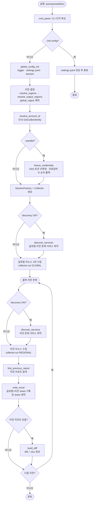
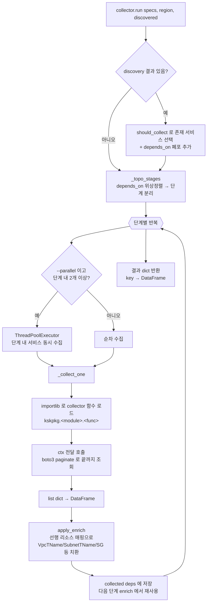
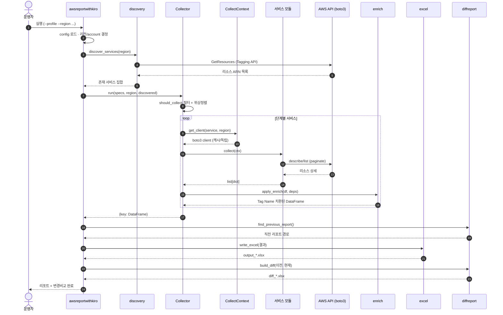
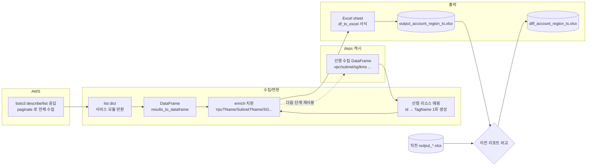

# awsreportwithkiro — AWS 리소스 현황 자동 추출 도구 (멀티 리전 / AI 서비스 확장판)

작성자: k.s.k & kiro

기존 `awsreport.py`의 설계 사상을 계승하여, AWS 리소스 현황을 Boto3로 수집하고 운영자 인지성을 높인 Excel 리포트를 생성합니다. 본 확장판은 **멀티 리전 전면 지원**, **선언형 서비스 레지스트리 기반 확장성**, **신규 AI 서비스(Bedrock / Bedrock AgentCore Gateway / SageMaker / API Gateway)** 를 추가했습니다.

---

## 1. 주요 특징

- AWS 현재 구성 정보를 Boto3 SDK로 수집하여 **Excel 스냅샷**으로 생성
- 리소스별로 **Excel sheet 분리** → 단순하고 빠른 확인
- 리소스의 **Tag Name 정보를 함께 병기**하고, 연관 리소스(VPC/Subnet/SG/KMS 등)의 Tag Name을 교차 치환하여 논리적 매핑 제공 (Pandas DataFrame 활용)
- **멀티 리전**: 리전별 Excel 파일 분리 생성, 글로벌 리소스(Route53/CloudFront/글로벌 WAF/글로벌 ACM)는 각 리전 파일에 공통 포함
- **Paginator** 기반 대량 리소스 자동 처리
- **선언형 레지스트리**로 서비스 추가가 쉬움 (레지스트리 1줄 + 모듈 함수)
- **순차 기본 / `--parallel` 옵션** (AWS SSO 안전장치 포함)

---

## 2. 설치

### 2.1 요구 사항
- Python 3.12 이상 (3.13 권장, 3.14에서도 동작 확인)
- AWS 자격증명 구성 (`aws configure` 또는 SSO 프로파일)

### 2.2 패키지 설치
```bash
pip install -r requirements.txt
```

설치되는 주요 패키지:

| 패키지 | 용도 |
|--------|------|
| boto3 / botocore | AWS SDK |
| pandas | DataFrame 처리 / 교차 참조 |
| numpy | 수치 처리 (컬럼폭 계산 등) |
| XlsxWriter | Excel 서식 출력 |
| openpyxl | Excel 보조 |
| PyYAML | settings.yaml 로드 |

### 2.3 폐쇄망(오프라인) 배포
인터넷이 차단된 환경에는 **단일 실행파일(방법 B)** 을 기본으로 사용합니다. 대상 PC에 Python 설치가 어려운 경우가 많기 때문입니다. (대상에 Python 3.12+ 가 표준화돼 있으면 방법 A도 가능 — 아래 참고)

공통 전제: **빌드는 인터넷 가능 PC에서, 폐쇄망 대상과 동일한 OS·아키텍처**로 수행합니다. PyInstaller는 크로스 컴파일을 지원하지 않습니다.

> 참고: 폐쇄망이라도 **AWS API 엔드포인트와 통신 가능한 네트워크**(또는 VPC 엔드포인트/프록시)는 있어야 리소스를 수집할 수 있습니다. 이 도구는 "인터넷에서 패키지 설치가 안 되는" 환경을 위한 것입니다.

#### ▶ 방법 B (기본) — 단일 실행파일, 대상 PC에 Python 불필요

```bash
# [1단계] 인터넷 PC(폐쇄망 대상과 동일 OS)에서 빌드
#   Windows : powershell -ExecutionPolicy Bypass -File .\build\build_exe.ps1
#   Linux   : bash build/build_exe.sh
# → dist/awsreportwithkiro(.exe)  단일 실행파일 (약 100MB) 생성
#   (boto3/botocore 서비스 모델 + 설정 파일이 내장됨)
```

```bash
# [2단계] 폐쇄망으로 실행파일만 반입 후, 설정 파일 생성 (최초 1회)
.\awsreportwithkiro.exe --init-config          # Windows → 실행파일 옆에 settings.yaml 생성
./awsreportwithkiro --init-config              # Linux

# [3단계] settings.yaml 의 regions / global_region / discovery / diff 등을 편집

# [4단계] 실행
.\awsreportwithkiro.exe --profile <name> --region ap-northeast-2   # Windows
./awsreportwithkiro --profile <name> --region ap-northeast-2       # Linux
```

운영 포인트:
- `--init-config` 로 만든 **실행파일 옆 `settings.yaml` 이 내장 기본값보다 우선** 적용됩니다(없으면 내장 기본 사용). 이미 있으면 덮어쓰지 않습니다.
- CLI 인자(`--region` 등)는 settings.yaml 보다 우선합니다. 설정 파일 없이 CLI 인자만으로도 실행 가능합니다.
- 출력(엑셀/diff)과 로그(ksk.log/ksk.dat)는 **실행한 현재 폴더**에 생성됩니다.

#### 방법 A (대안) — 오프라인 wheel 번들, 대상 PC에 Python 3.12+ 있음
```bash
# [1단계] 인터넷 PC: 의존성 wheel 다운로드
#   Windows: powershell -ExecutionPolicy Bypass -File .\offline\download_wheels.ps1
#   Linux  : bash offline/download_wheels.sh
# [2단계] 폐쇄망 PC: 오프라인 설치 (소스+offline 폴더 반입 후)
#   Windows: powershell -ExecutionPolicy Bypass -File .\offline\install_offline.ps1
#   Linux  : bash offline/install_offline.sh
# 실행: .\.venv\Scripts\python.exe awsreportwithkiro.py --profile <name> --region ap-northeast-2
```

| 비교 | 방법 B (기본·단일 실행파일) | 방법 A (wheel 번들) |
|------|-----------------------------|---------------------|
| 대상 PC에 Python | **불필요** | 필요 (3.12+) |
| 반입물 | 실행파일 1개 | 소스 + wheels 폴더 |
| 산출물 크기 | 약 100MB | 작음(수 MB) |
| 설정 수정 | `--init-config` 로 생성한 settings.yaml | 소스/settings.yaml 직접 |
| 적합 상황 | Python 설치 불가 환경 | Python 표준화된 환경 |

---

## 3. 실행 방법

```bash
# 기본 (settings.yaml 의 대상 리전으로 수집)
python awsreportwithkiro.py

# 특정 프로파일 + 멀티 리전
python awsreportwithkiro.py --profile myprofile --region ap-northeast-2 us-east-1

# 출력 파일 접두어 지정
python awsreportwithkiro.py -o myreport

# 병렬 수집 (SSO 사용 시 credential 선확정 안전장치 자동 적용)
python awsreportwithkiro.py --parallel
```

### 3.1 CLI 옵션
| 옵션 | 설명 |
|------|------|
| `--profile NAME` | AWS 프로파일 이름 |
| `--region R1 R2 ...` | 대상 리전 목록 (공백 구분). 미지정 시 settings.yaml 사용 |
| `--parallel` | 서비스 병렬 수집 활성화 (기본은 순차) |
| `--full` / `--no-discover` | Discovery 끄고 **전량 수집** (없는 서비스도 호출 + 빈 sheet 생성) |
| `--no-diff` | 이전 리포트와의 **변경 비교(diff)** 생성을 끈다 |
| `--init-config` | 실행 파일 옆에 편집 가능한 `settings.yaml` 생성 후 종료 (단일 실행파일 배포용) |
| `-o PREFIX` | 출력 파일 접두어 (기본 `output`) |

### 3.4 변경 비교 (diff) — 이전 리포트와 차이 자동 생성
리포트 생성 후, 같은 폴더에서 **같은 account/region/prefix 의 직전 리포트**를 찾아 현재 결과와 비교하고 변경사항을 별도 엑셀로 만듭니다 (기본 ON).

- 파일명: `diff_<account>_<region>_<timestamp>.xlsx`
- **Summary** sheet: 전체 변경 유무(YES/NO), 비교 대상 파일명, 총 변경 건수
- **ChangeCountBySheet** sheet: 리소스 유형별 Changed(Y/N) / Added / Removed / Modified 건수
- **chg_\<sheet\>** sheet: 변경이 있는 리소스 유형별 상세
  - `ChangeType` = Added(신규) / Removed(삭제) / Modified(값 변경)
  - Modified 는 바뀐 컬럼(`ChangedColumns`)과 Before/After 값 표시
- 리소스 매칭은 유형별 key 컬럼(예: VpcId, InstanceId, ARN 등 — `registry.py` 의 `key_columns`)으로 수행
- 이전 리포트가 없으면 자동 생략. `--no-diff` 로 끌 수 있음.

### 3.3 Discovery (기본 동작 — 존재하는 서비스만 문서화)
기본적으로 **조합 방식(C)** 으로 동작합니다.
1. 리전별로 Resource Groups Tagging API 로 **계정에 실제 존재하는 서비스**를 먼저 파악
2. 레지스트리에서 **존재하는 서비스만** 상세 수집 → sheet 생성
3. 없는 서비스는 **API 호출 생략 + 문서(sheet) 생략**

안전장치:
- 다른 서비스의 enrich 선행 리소스(VPC/Subnet/SG/KMS 등)와 커버리지 밖 서비스는 `always_collect`로 **항상 수집**(누락 방지).
- Discovery 자체가 실패하면 해당 리전은 **전량 수집으로 자동 폴백**.
- `--full`(또는 `--no-discover`)로 Discovery를 끄면 기존처럼 전량 수집 + 모든 sheet 생성.
- `settings.yaml`의 `discovery.emit_empty_sheets: true`로 바꾸면 Discovery ON 상태에서도 빈 sheet를 생성합니다.

### 3.2 출력 파일
- 형식: `output_<account>_<region>_<timestamp>.xlsx`
- 출력 파일은 **`global_region`을 제외한 리전마다 1개씩** 생성됩니다. `global_region`(기본 us-east-1)은 글로벌 리소스 수집 전용이라 단독 파일을 만들지 않습니다.
- 글로벌 리소스(Route53/CloudFront/글로벌 WAF/글로벌 ACM)는 1회만 수집되어 **생성되는 각 리전 파일에 공통으로 중복 포함**됩니다.

예시 (`global_region: us-east-1` 기준):

| regions 설정 | 생성되는 파일 | 글로벌 리소스 |
|--------------|---------------|----------------|
| `[us-east-1, ap-northeast-2]` | ap-northeast-2 (1개) | ap-northeast-2 파일에 포함 |
| `[us-east-1, ap-northeast-2, ap-northeast-1]` | ap-northeast-2, ap-northeast-1 (2개) | 두 파일에 각각 중복 포함 |
| `[ap-northeast-2]` | ap-northeast-2 (1개) | ap-northeast-2 파일에 포함 |
| `[us-east-1]` | us-east-1 (1개, 예외 fallback) | us-east-1 파일에 포함 |

---

## 4. 처리 구조 (호출 흐름)

프로그램의 전체 실행 흐름과 핵심 컴포넌트 간 호출 관계입니다. (GitHub 등에서 Mermaid 다이어그램으로 렌더링됩니다.)

### 4.1 전체 실행 흐름



### 4.2 서비스 수집 엔진 (collector.run 내부)

레지스트리에 선언된 서비스를 `depends_on` 위상정렬 단계로 나눠 수집하고, 각 결과에 연관 리소스의 Tag Name을 교차 치환합니다.



### 4.3 컴포넌트 역할 요약

| 컴포넌트 | 파일 | 역할 |
|----------|------|------|
| 진입점 | `awsreportwithkiro.py` | CLI 파싱, 리전/Discovery/diff 오케스트레이션, Excel 출력 |
| 레지스트리 | `kskpkg/registry.py` | 서비스 선언(수집함수/순서/의존/enrich/key) — **확장 지점** |
| 수집 엔진 | `kskpkg/collector.py` | 위상정렬, 순차/병렬 수집, enrich 적용 |
| 실행 컨텍스트 | `kskpkg/context.py` | 세션/client 캐시, SSO credential 선확정 |
| 탐색 | `kskpkg/discovery.py` | Tagging API 로 존재 서비스 파악(조합 방식 C) |
| 치환 | `kskpkg/enrich.py` | 연관 리소스 Tag Name 교차 치환 |
| 출력 | `kskpkg/excel.py` | DataFrame → 서식 적용 Excel sheet |
| 비교 | `kskpkg/diffreport.py` | 이전/현재 리포트 변경 비교 |
| 서비스 모듈 | `kskpkg/<service>.py` | boto3 호출 → `list[dict]` 반환 |

### 4.4 시퀀스 다이어그램 (컴포넌트 간 호출 순서)

한 리전을 수집할 때 컴포넌트 사이에서 일어나는 호출을 시간 순서로 나타냅니다.



### 4.5 데이터 흐름도 (리소스 → Excel/diff)

리소스 데이터가 수집부터 출력까지 어떻게 변환·치환되는지를 나타냅니다. 핵심은 선행 리소스 DataFrame을 **deps 캐시로 재사용**하여 Tag Name을 1회 매핑으로 치환하는 부분입니다.



---

## 5. 설정 파일 (`kskpkg/config/settings.yaml`)

```yaml
default_region: ap-northeast-2   # regions 가 비면 이 리전 하나만 처리
regions:                         # 대상 리전 목록 (여러 개면 파일 분리)
  - ap-northeast-2
global_region: us-east-1         # 글로벌 리소스 엔드포인트
output_prefix: output
concurrency:
  regions: 4                     # (--parallel 시) 리전 동시 실행 수
  services: 8                    # (--parallel 시) 서비스 동시 실행 수
sso_min_remaining_minutes: 15    # 토큰 만료 임박 시 순차 폴백 임계값
services:
  disabled: []                   # 수집 제외할 서비스 key 목록
```

---

## 6. 수집 대상 서비스

### 6.1 글로벌 (us-east-1)
Route53(호스팅 영역/레코드), CloudFront(배포/OAI), 글로벌 ACM, 글로벌 WAF(CLOUDFRONT)

### 6.2 리전별 (기존 서비스)
VPC, Subnet, IGW, NAT, EIP, ENI, EC2 Instance, Security Group, Managed Prefix List,
**Route Table(router/routeinfo), VPC Endpoint**,
ELB(v2), **ELB Listener, ELB Listener Rule, ELB Target Group, ELB Target Binding(타깃 헬스)**,
EKS(+**Addon, Nodegroup, Fargate Profile**), ECS(+Service), **AWS Batch(컴퓨트환경/작업큐/작업정의)**, EFS, S3, ECR, KMS, RDS, Redshift, ElastiCache, DynamoDB(테이블/글로벌테이블),
MSK(Kafka), SQS, SNS, SES, 리전 ACM, Secrets Manager, SSM Parameter Store, Backup(플랜/볼트),
리전 WAF, Cloud Map, Lambda, Cognito(ID풀/유저풀), CodeCommit, CodeBuild, CodeDeploy(앱/배포), CodePipeline, Athena

> 네트워크/ELB 연관 리소스는 route53/route53_record 처럼 관점별 sheet 로 분리하고,
> 참조 리소스의 Tag Name(`<서비스>TName`)을 함께 제공한다.
> 예) router→SubnetTName/VpcTName, routeinfo→NatGatewayTName/InstanceTName/ENITName,
>     vpcendpoint→VpcTName/SubnetTName/SecurityGroupTName,
>     elb_targetgroup→VpcTName/LoadBalancerName, elb_targetbinding→TargetTName(인스턴스 타깃)

### 6.3 신규 AI / 추가 서비스
- **Amazon Bedrock** — custom models, guardrails
- **Amazon Bedrock AgentCore Gateway** — gateways + gateway targets (client: `bedrock-agentcore-control`)
- **Amazon SageMaker** — domains, endpoints
- **Amazon API Gateway** — REST(v1), HTTP/WebSocket(v2)

> 신규 AI 서비스는 미지원 리전/구버전 boto3 환경에서 예외를 빈 스켈레톤으로 안전 처리합니다.

---

## 7. 서비스 추가 방법 (확장 가이드)

새 서비스 추가는 **두 단계**면 됩니다.

### (1) 수집 모듈 작성 — `kskpkg/<service>.py`
수집 함수는 `ctx` 하나를 받아 `list[dict]` 를 반환합니다. 빈 경우 컬럼 스켈레톤, 에러 시 `ERROR CHECK` 행을 반환하는 패턴을 지킵니다.

```python
from .config import awsglobal
from .utils import paginate
klogger = awsglobal.klogger

def list_things(ctx):
    results = []
    try:
        client = ctx.get_client("myservice")
        for item in paginate(client, "list_things", "Things"):
            results.append({"Name": item.get("name", " "), "Region": ctx.region})
        if not results:
            results.append({"Name": " ", "Region": ctx.region})
    except Exception as err:
        klogger.error("myservice.list_things(),%s", err)
        results = [{"Name": "ERROR CHECK", "Region": ctx.region}]
    return results
```

### (2) 레지스트리 등록 — `kskpkg/registry.py`
```python
ServiceSpec("mything", "mything", "REGIONAL", "kskpkg.myservice.list_things", order=300,
            arn_services=["myservice"])   # Discovery 대조용 ARN service 토큰
```

> `arn_services`: Discovery(Tagging API)가 반환하는 ARN의 service 토큰(예: `ec2`, `rds`, `elasticloadbalancing`). 계정에 해당 서비스가 없으면 수집/문서를 생략한다.
> 선행 의존 리소스이거나 Tagging API 커버리지 밖이면 `always_collect=True`로 항상 수집하게 한다.

선행 리소스의 Tag Name 치환이 필요하면 `depends_on` 과 `enrich` 를 추가합니다.
```python
ServiceSpec("mything", "mything", "REGIONAL", "kskpkg.myservice.list_things", order=300,
            depends_on=["vpc"],
            enrich=[("VpcTName", "vpc", "get_vpcname", "VpcId")])
```

`enrich` 규칙 튜플: `(생성컬럼, 참조 dep_key, enrich함수명, id컬럼)`
사용 가능한 enrich 함수: `get_vpcname`, `get_subnetname`, `get_sgname`, `get_keyalias`,
`get_insname`, `get_eniname`, `get_eipname`, `get_elbname`, `get_ecsclustername`
(필요 시 `kskpkg/enrich.py` 의 `_RESOLVER` 에 `함수명: (id컬럼, name컬럼)` 추가)

**Tag Name 치환 동작 방식 (성능)**
- 선행 리소스(예: VPC)를 **1회 수집한 DataFrame** 에서 `{id: TagName}` 매핑을 **규칙당 1회만 생성**하여 재사용합니다. 매 행마다 참조 DataFrame 을 재스캔하거나 AWS API 를 재호출하지 않습니다.
- `id컬럼` 값이 **리스트**(예: 보안그룹 `['sg-1','sg-2']`)인 경우, 각 원소를 치환한 **리스트**(`['web-sg','app-sg']`)로 생성됩니다. 단일 값이면 단일 TagName 을 반환합니다.
- 매핑에서 못 찾으면 원래 id 를 보존(또는 공백)하여 정보 손실을 방지합니다.

**페이지네이션**
- `utils.paginate(client, operation, result_key, **kwargs)` 는 boto3 Paginator 가 있으면 끝까지 순회하고, 없으면 단일 호출합니다.
- Paginator 미지원 API(예: `dynamodb.list_global_tables`, `wafv2.list_web_acls`)는 각 모듈에서 `NextMarker`/`ExclusiveStart...` 수동 루프로 끝까지 조회합니다.

---

## 8. 디렉토리 구조

```
awsreportwithkiro/
├── awsreportwithkiro.py     # 실행 진입점 (오케스트레이션)
├── awsreportwithkiro.spec   # PyInstaller 단일 실행파일 빌드 spec (방법 B)
├── requirements.txt
├── README.md
├── build/                   # 단일 실행파일 빌드 스크립트
│   ├── build_exe.ps1
│   └── build_exe.sh
├── offline/                 # 오프라인 wheel 번들 스크립트 (방법 A)
│   ├── download_wheels.ps1 / .sh
│   └── install_offline.ps1 / .sh
└── kskpkg/
    ├── registry.py          # 서비스 레지스트리 (확장 지점, key_columns 포함)
    ├── context.py           # 세션/client 캐시, SSO credential 선확정
    ├── collector.py         # 수집 엔진 (순차/병렬, depends_on 위상정렬)
    ├── discovery.py         # Tagging API 기반 존재 서비스 탐색 (조합 방식 C)
    ├── enrich.py            # Tag Name 교차참조 치환
    ├── diffreport.py        # 이전/현재 리포트 변경 비교(diff)
    ├── excel.py             # Excel 서식 출력
    ├── utils.py             # 공통 유틸 (paginate, tag 추출, 예외 분류 등)
    ├── config/
    │   ├── awsglobal.py     # 전역/로거/설정 로더
    │   ├── settings.yaml    # 런타임 설정
    │   └── logging.conf
    └── <service>.py ...     # 서비스별 수집 모듈 (ec2, elb, eks, batch, bedrock ...)
```

---

## 9. AWS SSO 와 병렬 수집 참고

`--parallel` 사용 시 다중 스레드가 동일 Session 의 SSO 토큰 갱신을 동시에 트리거하면 재인증 경합/연결 리셋이 발생할 수 있습니다. 이를 방지하기 위해:

1. 수집 시작 전 메인 스레드에서 credential 을 1회 **선확정(freeze)** 하고 워커 스레드가 이를 공유합니다.
2. botocore client 는 thread-safe 하지 않으므로 **스레드/리전/서비스별 독립 client** 를 생성합니다.
3. 토큰 만료까지 여유(`sso_min_remaining_minutes`)가 부족하면 **순차로 자동 폴백**합니다.

기본값은 순차 수집으로 가장 안전합니다. 대량 리전/리소스에서 속도가 필요할 때만 `--parallel` 을 사용하세요.

---

## 10. 참고자료
1. [Python용 AWS SDK (Boto3)](https://aws.amazon.com/ko/sdk-for-python/)
2. [XlsxWriter 문서](https://xlsxwriter.readthedocs.io/)
3. [Amazon Bedrock AgentCore Gateway](https://docs.aws.amazon.com/bedrock-agentcore/latest/devguide/gateway.html)
